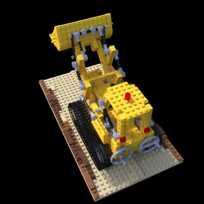
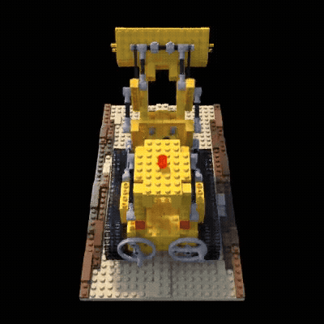
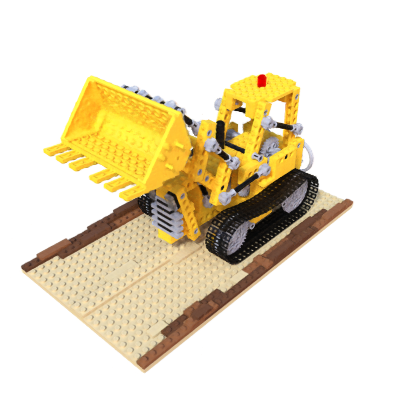
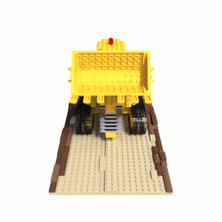

# NeRF: Representing Scenes as Neural Radiance Fields for View Synthesis

My PyTorch implementation of [NeRF](https://arxiv.org/abs/2003.08934), trained on the Blender
LEGO scene. It has the usual pieces: positional encoding, a coarse and a fine MLP, hierarchical
sampling and volume rendering. Everything runs in plain fp32 (TF32 is switched off).

## Setup

```bash
python3 -m venv .venv
.venv/bin/pip install torch torchvision --index-url https://download.pytorch.org/whl/cu126
.venv/bin/pip install -r requirements-dev.txt   # requirements.txt + pytest, ruff
```

Put the dataset in `data/synthetic/lego/` (the `train/`, `val/` and `test/` folders plus the
three `transforms_*.json` files).

## Usage

The quickest way is the script that does everything: train, evaluate on the test set, then
render a fly-around video.

```bash
./run_lego.sh                                # uses configs/synthetic_lego.yaml
./run_lego.sh training.max_steps=200000      # extra arguments become --set overrides
```

Or run the steps one at a time:

```bash
# Train. With --resume it picks up from logs/<expname>/checkpoint_last.pth, including the
# optimizer, RNG state and occupancy grid, so an interrupted run continues where it stopped.
.venv/bin/python -m scripts.train --config configs/synthetic_lego.yaml --expname lego_v2 --resume

# Score all 200 test views. Writes outputs/v2/eval/metrics.json, per_view.csv and the renders.
.venv/bin/python -m scripts.evaluate --config configs/synthetic_lego.yaml \
    --ckpt logs/lego_v2/checkpoint_last.pth --outdir outputs/v2

# 360 degree fly-around as MP4 plus a small GIF
.venv/bin/python -m scripts.render --config configs/synthetic_lego.yaml \
    --ckpt logs/lego_v2/checkpoint_last.pth --path spherical --n_frames 120 \
    --outdir outputs/v2/video_frames --video outputs/v2/video.mp4 --gif outputs/v2/video.gif

# Re-score the old v1 renders
.venv/bin/python -m scripts.evaluate_saved_renders

# Check that the occupancy grid's bounding box really contains the object
.venv/bin/python -m scripts.check_aabb

# Tests (CPU is enough)
NERF_DEVICE=cpu .venv/bin/python -m pytest -q
```

Training shows a progress bar with the current loss, PSNR and latest val PSNR. Everything is
also logged to TensorBoard (`tensorboard --logdir logs`) and to `logs/<expname>/metrics.jsonl`:
loss, train and val PSNR, learning rate, ms per step, peak GPU memory and the occupancy grid
stats.

## Results

### v1 (original code, trained on a cloud A100)

| View | PSNR | SSIM |
|---|---|---|
| r_150 | 30.82 dB | 0.9481 |
| r_162 | 29.93 dB | 0.9454 |
| r_178 | 28.83 dB | 0.9395 |
| r_193 | 30.03 dB | 0.9459 |
| Mean of the 4 views | 29.90 dB | 0.945 |

I don't have the v1 model anymore, only these four renders (`outputs/150.png` to `193.png`,
400x400), so they're the only views I can score. To match how the v1 loader prepared the ground
truth, the script loads it with `convert("RGB")`, which throws away alpha and leaves a black
background, then resizes with LANCZOS. `scripts/evaluate_saved_renders.py` reproduces the
numbers above. Keep in mind this is four hand-picked views on black, so it can't be compared
with the paper (800x800, white background, all 200 test views) or with v2.

| Frame 150 | Frame 162 | Frame 178 | Frame 193 |
|---|---|---|---|
|  |  |  |  |



### v2 (this code, trained on my RTX 3060 laptop)

| All 200 test views | Mean ± std | Min | Max |
|---|---|---|---|
| PSNR | 31.20 ± 1.35 dB | 27.73 dB | 33.40 dB |
| SSIM | 0.9615 ± 0.0051 | 0.9469 | 0.9729 |

I trained for 200,000 steps with `./run_lego.sh training.max_steps=200000` at commit `5df01d3`.
It took 7 h 28 min including validation and checkpointing, at roughly 130 ms per step and
2.97 GiB of peak GPU memory. Validation PSNR was 24.53 dB after 10k steps, 29.65 dB at 100k
and 31.46 dB at the end, and it was still creeping up, so a longer run would probably gain a
little more.

The numbers come from `scripts/evaluate.py` and are scored on the saved 8-bit renders at
400x400 against ground truth composited onto white. Rendering is deterministic, so running the
evaluation again gives exactly the same result. The raw output is in
`outputs/v2/eval/metrics.json` and `per_view.csv`, and [docs/RESULTS.md](docs/RESULTS.md) has
the unrounded values and the full protocol. Because v2 uses every test view on a white
background, it isn't an apples-to-apples comparison with the v1 table.

The same four viewpoints v1 saved, rendered by v2:

| r_150 | r_162 | r_178 | r_193 |
|---|---|---|---|
|  |  |  |  |
| 32.67 dB | 33.12 dB | 30.53 dB | 31.33 dB |



The GIF is downscaled; the full-quality version is [video.mp4](outputs/v2/video.mp4).

### What changed between v1 and v2

| | Change |
|---|---|
| P1 | Ground truth is loaded as RGBA, resized with LANCZOS (Pillow premultiplies alpha) and composited onto white, which matches how the renderer composites (`data.white_bkgd`). |
| P2 | Rendering for evaluation is deterministic: no coarse jitter and no random fine sampling. The same view always renders to the same image. |
| P3 | Center-crop warm-up: for the first 500 steps, rays are only sampled from the middle 50% of each image. |
| P4 | Learning rate decay: `lr = 5e-4 * 0.1^(step / 500000)`, the same schedule as nerf-pytorch. |
| P5 | Full checkpoints with the models, Adam state, LR schedule, step, all RNG states, config, git SHA and occupancy grid. They're written atomically, and the newest 3 are kept along with `checkpoint_last.pth`, so `--resume` continues exactly where training stopped. |
| P6 | Validation: every `val_interval` steps, three fixed val views are rendered and `val/psnr` is logged. |
| P7 | Evaluation scripts: `scripts/evaluate.py` for v2 on all test views and `scripts/evaluate_saved_renders.py` for the old v1 renders. |
| P8 | Training images stay on the GPU, and rays are only built for the pixels sampled each step. |
| Fix | The fine sample depths are now detached, as in the paper. Before, gradients from the fine network leaked into the coarse network's weights. |
| Fix | Gaussian noise (std 1.0) is added to the raw density during training, a regulariser from the paper. With the center crop alone, one of three seeds collapsed: the fine MLP's density went negative everywhere, the ReLU stopped passing gradients and it rendered plain white. With the noise, all three seeds trained normally. |
| New | An occupancy grid (128³ cells over `[-1.5, 1.5]³`, written from scratch in PyTorch) that lets samples in empty space skip the MLPs. See the ablation below. |
| New | `torch.compile` and fused Adam are on by default. Both keep fp32 math. In a 220-step comparison they only made about a 1% difference (245.9 vs 248.2 ms/step) and saved 0.22 GiB. |

#### Occupancy grid ablation

To check that the grid doesn't hurt quality, I ran 5000 steps with it on and off, with seed 0
and everything else equal (commit `34150ef`). Val PSNR is the mean over val views r_0, r_33
and r_66.

| | Grid off | Grid on |
|---|---|---|
| ms/step (median, steps ≥ 600) | 223.1 | 93.0 |
| Wall clock for 5000 steps (incl. 5 validations) | 22 min 39 s | 12 min 57 s |
| Val PSNR at step 4999 | 23.19 dB | 23.19 dB |
| Val PSNR at steps 2000 / 3000 / 4000 | 21.34 / 22.24 / 23.08 dB | 21.06 / 21.84 / 22.91 dB |
| Fraction of samples skipped | 0 | 0.656 (mean over steps ≥ 1000) |

Same final PSNR at about 2.4x the speed, so the grid is on by default. Each run used
`python -m scripts.train --config configs/synthetic_lego.yaml --expname t31_grid_{off,on} --set training.max_steps=5000 training.val_interval=1000 occupancy.enabled={false,true}`.
