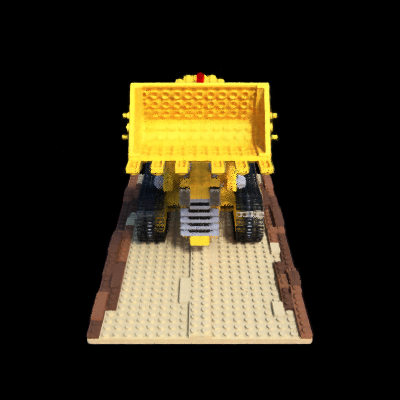
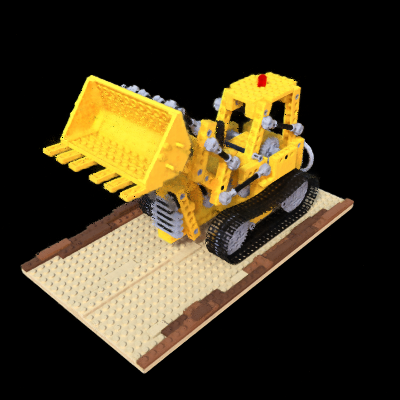
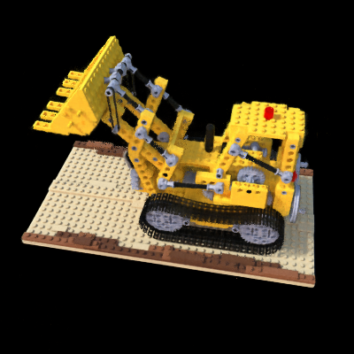
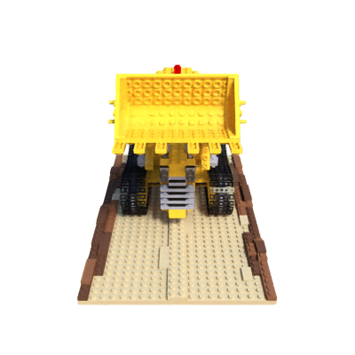
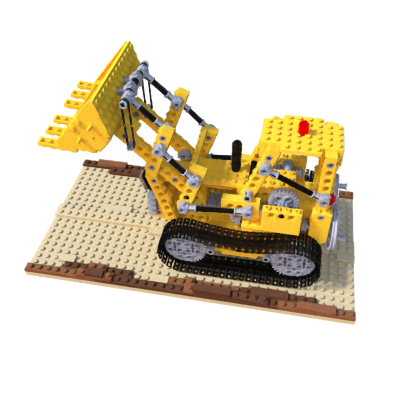
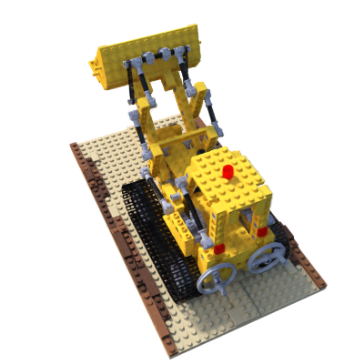

# NeRF: Representing Scenes as Neural Radiance Fields for View Synthesis

A PyTorch implementation of [NeRF](https://arxiv.org/abs/2003.08934): coarse and fine MLPs,
positional encoding and volume rendering, trained on the Blender **LEGO** scene. All training
and evaluation runs in full fp32 (TF32 disabled).

## Setup

```bash
python3 -m venv .venv
.venv/bin/pip install torch torchvision --index-url https://download.pytorch.org/whl/cu126
.venv/bin/pip install -r requirements-dev.txt   # requirements.txt + pytest, ruff
```

The dataset goes in `data/synthetic/lego/` (`train/`, `val/`, `test/` and
`transforms_{train,val,test}.json`).

## Usage

The whole pipeline (train, then evaluate, then render the fly-around):

```bash
./run_lego.sh                                # uses configs/synthetic_lego.yaml
./run_lego.sh training.max_steps=200000      # any --set override for training
```

The individual steps:

```bash
# Train. --resume continues from logs/<expname>/checkpoint_last.pth (models, Adam,
# RNG and occupancy grid are restored).
.venv/bin/python -m scripts.train --config configs/synthetic_lego.yaml --expname lego_v2 --resume

# Evaluate all 200 test views -> outputs/v2/eval/metrics.json, per_view.csv, outputs/v2/test/NNN.png
.venv/bin/python -m scripts.evaluate --config configs/synthetic_lego.yaml \
    --ckpt logs/lego_v2/checkpoint_last.pth --outdir outputs/v2

# 360-degree fly-around -> MP4 and a small GIF
.venv/bin/python -m scripts.render --config configs/synthetic_lego.yaml \
    --ckpt logs/lego_v2/checkpoint_last.pth --path spherical --n_frames 120 \
    --outdir outputs/v2/video_frames --video outputs/v2/video.mp4 --gif outputs/v2/video.gif

# Reproduce the v1 numbers from the saved v1 renders
.venv/bin/python -m scripts.evaluate_saved_renders

# Check that the occupancy-grid box contains the object (visual hull of the training masks)
.venv/bin/python -m scripts.check_aabb

# Tests (CPU is enough)
NERF_DEVICE=cpu .venv/bin/python -m pytest -q
```

TensorBoard (`tensorboard --logdir logs`) shows `loss/train`, `psnr/train`,
`psnr/train_coarse`, `val/psnr`, `lr`, `time/ms_per_step`, `mem/peak_gib` and the occupancy
statistics. The same values go to `logs/<expname>/metrics.jsonl`.

## Results

### v1 (original code, cloud A100)

| View | PSNR | SSIM |
|---|---|---|
| r_150 | 30.82 dB | 0.9481 |
| r_162 | 29.93 dB | 0.9454 |
| r_178 | 28.83 dB | 0.9395 |
| r_193 | 30.03 dB | 0.9459 |
| **Mean (4 views)** | **29.90 dB** | **0.945** |

These numbers come from the 4 saved v1 renders (`outputs/150.png` … `193.png`) at 400×400.
The ground truth is prepared the way v1's loader did it: `convert("RGB")`, which drops alpha
and gives a **black** background, then a LANCZOS resize. Reproduce them with
`scripts/evaluate_saved_renders.py`. The v1 model no longer exists, so only these 4 views can
be scored. Four hand-picked views on a black background are **not** comparable to the NeRF
paper (800×800, white background, all 200 test views) or to v2 below.

| Frame 150 | Frame 162 | Frame 178 | Frame 193 |
|---|---|---|---|
|  |  |  |  |


### v2 (improved code, RTX 3060 Laptop, fp32)

| Metric (all 200 test views) | Mean ± std | Min | Max |
|---|---|---|---|
| PSNR | **31.20 ± 1.35 dB** | 27.73 dB | 33.40 dB |
| SSIM | **0.9615 ± 0.0051** | 0.9469 | 0.9729 |

- **Protocol:** 400×400, **white** background, deterministic rendering, scored on the 8-bit
  renders by `scripts/evaluate.py` (`outputs/v2/eval/metrics.json`, `per_view.csv`).
- **Training:** 200,000 steps in 7 h 28 min of wall-clock time (including validations and
  checkpoint saves) on an RTX 3060 Laptop GPU, fp32. About 130 ms/step, with a peak of 2.97 GiB
  of GPU memory.
- **Commit:** `5df01d3`. Command: `./run_lego.sh training.max_steps=200000`.
- **Val PSNR:** 24.53 dB at 10k steps, 29.65 at 100k and 31.46 at 199,999.

Exact values, the full protocol and the media list are in [docs/RESULTS.md](docs/RESULTS.md).
These numbers are not comparable to v1's: v2 uses all 200 views and a white background.

| Test r_150 | Test r_162 | Test r_178 | Test r_193 |
|---|---|---|---|
|  |  |  |  |
| 32.67 dB | 33.12 dB | 30.53 dB | 31.33 dB |

 ([MP4](outputs/v2/video.mp4))

### What changed from v1 to v2

| # | Change |
|---|---|
| P1 | Targets are loaded as RGBA, LANCZOS-resized (Pillow premultiplies alpha) and composited onto **white**, matching the renderer's white-background compositing (`data.white_bkgd`). |
| P2 | Rendering and evaluation are **deterministic** (`perturb=False`: no coarse jitter, deterministic fine sampling). The same view renders bit-identically. |
| P3 | **Center-crop warm-up:** for the first 500 steps, rays come only from the central 50% of the image. |
| P4 | **LR decay:** `lr = 5e-4 · 0.1^(step / 500000)`, as in nerf-pytorch. |
| P5 | **Full checkpoints:** models, Adam, LR schedule, step, Python/NumPy/torch/CUDA RNG, config, git SHA and occupancy grid. Writes are atomic and the newest 3 checkpoints plus `checkpoint_last.pth` are kept. `--resume` continues exactly. |
| P6 | **Validation:** every `val_interval` steps, 3 fixed val views are rendered and `val/psnr` is logged. |
| P7 | **Evaluation scripts:** `scripts/evaluate.py` (v2, all test views) and `scripts/evaluate_saved_renders.py` (v1). |
| P8 | Training images stay on the GPU, and rays are built only for the sampled pixels. |
| — | **Gradient stop through importance sampling:** fine-sample depths are detached, as in the paper. Before this fix, fine-network gradients flowed into the coarse weights. |
| — | **Raw density noise** (std 1.0 during training only; the paper's own regulariser). With the center crop alone, 1 of 3 seeds collapsed: the fine MLP's raw density went negative everywhere, its ReLU had zero gradient, and it rendered white. With the noise, all 3 seeds train normally. |
| — | **Occupancy grid** for empty-space skipping (own PyTorch code, 128³ over `[-1.5, 1.5]³`): samples in empty cells skip the MLPs (see the ablation below). |
| — | `torch.compile` and fused Adam (both keep fp32 math) are on by default. In a 220-step comparison they changed the step time by only about 1% (245.9 vs 248.2 ms/step) and saved 0.22 GiB of memory. |

#### Occupancy-grid ablation

5000 steps, seed 0, all other settings equal (commit `34150ef`). Val PSNR is the mean over
val r_0, r_33 and r_66.

| | Grid off | Grid on |
|---|---|---|
| ms/step (median, steps ≥ 600) | 223.1 | 93.0 |
| Wall clock, 5000 steps (incl. 5 validations) | 22 min 39 s | 12 min 57 s |
| Val PSNR at step 4999 | 23.19 dB | 23.19 dB |
| Val PSNR at steps 2000 / 3000 / 4000 | 21.34 / 22.24 / 23.08 dB | 21.06 / 21.84 / 22.91 dB |
| Skipped sample fraction | 0 | 0.656 (mean, steps ≥ 1000) |

Command for each run:
`python -m scripts.train --config configs/synthetic_lego.yaml --expname t31_grid_{off,on} --set training.max_steps=5000 training.val_interval=1000 occupancy.enabled={false,true}`.
